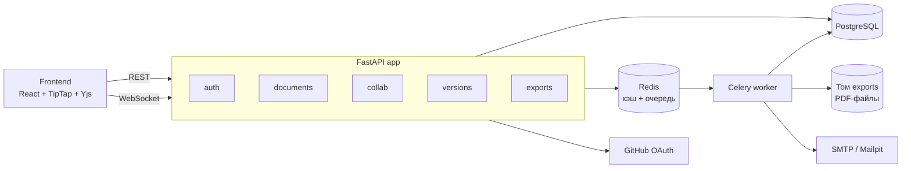

# План задач: платформа совместного редактирования

Мини-аналог Google Docs: несколько человек одновременно редактируют документ, есть роли, история версий и экспорт в PDF.

## Как работаем

1. Берёшь **первую свободную задачу сверху**, у которой закрыты все зависимости (`после: …`). Дописываешь своё имя: `- [ ] 07 … — @имя`, коммитишь сразу.
2. Отдаёшь нейронке **текст задачи целиком**. Она также читает `AGENTS.md` (там стек и правила).
3. Одна задача = одна ветка от `develop` (например `task-07-github-oauth`) = один PR в `develop`.
4. PR ревьюит **любой другой участник**. Мерж только при зелёном CI.
5. В том же PR ставишь `[x]` у своей задачи.
6. Когда этап закрыт, кто-то один открывает PR `develop → main`. В `main` всегда лежит рабочая версия.

Буквы у задач (A, B, C) подсказывают, кому их удобнее брать, чтобы не толкаться в одних файлах. Это не жёсткое правило.
- **A**: редактор и фронтенд
- **B**: бэкенд и интеграции
- **C**: тесты, CI, инфраструктура, потом документация

## Архитектура (коротко)

**Модульный монолит**: одно FastAPI-приложение, разбитое на модули, плюс отдельный процесс worker. Обе роли запускаются из одного Docker-образа с разными командами.

| Что | Чем |
|---|---|
| API, WebSocket | FastAPI, Pydantic |
| Разрешение конфликтов | CRDT: `pycrdt` + `pycrdt-websocket` на сервере, Yjs в браузере |
| БД | PostgreSQL, SQLAlchemy 2 (async), Alembic |
| Кэш и очередь | Redis (кэш прав + брокер для Celery) |
| Фоновые задачи | Celery + Celery beat |
| Интеграции | GitHub OAuth, SMTP (локально Mailpit) |
| Фронтенд | Vite + React + TipTap (Collaboration) + y-websocket |
| Тесты | pytest, pytest-asyncio, httpx |
| Качество | ruff |
| Наблюдаемость | JSON-логи, `prometheus-fastapi-instrumentator`, `/health` |
| Запуск | Docker Compose |
| CI/CD | GitHub Actions → GHCR → деплой по SSH |

Роли в документе: `owner`, `editor`, `viewer`.

---

## Этап 0. Основа (делает один человек, по порядку)

- [ ] **01 Каркас репозитория** (C)
  Структура папок как в `AGENTS.md`. `backend/pyproject.toml` (uv), FastAPI-приложение с `GET /health` → `{"status":"ok"}`. Настройки через `pydantic-settings` и `.env.example`. Dockerfile для backend. `docker-compose.yml`: api, postgres, redis. Настроить ruff, добавить один pytest-тест на `/health`.
  **Готово, когда:** `docker compose up` поднимает API, `curl localhost:8000/health` отвечает 200, `uv run pytest` и `uv run ruff check .` проходят.

- [ ] **02 CI на каждый PR** (C), после: 01
  `.github/workflows/ci.yml`: ruff, затем pytest (Postgres и Redis как services). В настройках GitHub включить защиту `main` и `develop`: только через PR, нужен 1 approve и зелёный CI.
  **Готово, когда:** PR с ошибкой линтера красный, с исправлением зелёный.

- [ ] **03 База данных и модели** (B), после: 01
  Async SQLAlchemy, Alembic. Модели: `User` (id, email, password_hash nullable, github_id nullable, is_admin), `Document` (id, title, owner_id, ydoc_state bytes, created_at, updated_at), `DocumentMember` (document_id, user_id, role), `DocumentVersion` (id, document_id, state bytes, created_at, created_by). Первая миграция. Миграции применяются при старте контейнера.
  **Готово, когда:** после `docker compose up` в БД есть все таблицы.

## Этап 1. Три линии параллельно

- [ ] **04 Прототип совместного редактирования (сервер)** (A), после: 01
  WebSocket `/ws/documents/{id}` в FastAPI на `pycrdt-websocket`: одна комната (room) на документ. Пока без авторизации и без сохранения в БД.
  Подсказка: `WebsocketServer` из `pycrdt-websocket` принимает объект-канал, поэтому FastAPI `WebSocket` оборачивается в маленький адаптер (`path`, `send`, `recv`, async-итерация).
  **Готово, когда:** тест с двумя `pycrdt.Doc`-клиентами показывает, что правка одного доходит до второго.

- [ ] **05 Прототип редактора (фронт)** (A), после: 04
  `frontend/`: Vite + React + TipTap с расширениями `Collaboration` и `CollaborationCursor`, провайдер `y-websocket` на `/ws/documents/{id}`. Одна страница, id документа берётся из URL. Сервис frontend в compose.
  **Готово, когда:** два окна браузера редактируют один документ, видят текст и курсоры друг друга.

- [ ] **06 Регистрация и вход** (B), после: 03
  `POST /auth/register`, `POST /auth/login` → JWT access-токен. Пароли через `passlib[bcrypt]`/`argon2`. Зависимость `get_current_user`. `GET /users/me`.
  **Готово, когда:** API-тесты на регистрацию, вход, неверный пароль и запрос без токена (401) проходят.

- [ ] **07 Вход через GitHub (интеграция 1)** (B), после: 06
  OAuth-поток: `GET /auth/github/login` → редирект на GitHub, `GET /auth/github/callback` → создать или найти пользователя по `github_id`, выдать JWT. Ключи в `.env`.
  **Готово, когда:** вход через GitHub работает локально, а в тесте ответ GitHub замокан.

- [ ] **08 Документы и роли** (B), после: 06
  `POST/GET/PATCH/DELETE /documents`, `GET /documents` (мои и расшаренные), `POST /documents/{id}/members` (email + role), `DELETE /documents/{id}/members/{user_id}`. Зависимость `require_role("editor")`: owner может всё, editor может редактировать, viewer только читать. Удаление и шаринг доступны только owner.
  **Готово, когда:** API-тесты проверяют каждую роль, включая 403 там, где прав нет.

- [ ] **09 Логи, метрики, healthcheck** (C), после: 01
  Логи в JSON (structlog или stdlib) с `request_id` на каждый запрос. `/metrics` через `prometheus-fastapi-instrumentator` плюс своя метрика `ws_connections_active`. `/health/live` (процесс жив) и `/health/ready` (проверяет Postgres и Redis). Healthcheck-и в compose.
  **Готово, когда:** при остановленном Postgres `/health/ready` отдаёт 503, а `/metrics` отдаёт метрики.

- [ ] **10 Тестовая инфраструктура** (C), после: 03
  Фикстуры pytest: отдельная тестовая БД, которая чистится между тестами, `httpx.AsyncClient` к приложению, фабрики пользователей и токенов. Тесты разложены по `tests/unit`, `tests/integration`, `tests/api`.
  **Готово, когда:** в CI проходят все три папки, а новый API-тест пишется в 5 строк с готовыми фикстурами.

## Этап 2. Связываем части

- [ ] **11 Авторизация на WebSocket** (A), после: 04, 08
  Токен передаётся в query `?token=…`. Нет доступа → соединение закрывается с кодом 4403. Viewer получает обновления, но его изменения сервер игнорирует.
  **Готово, когда:** тесты проверяют 3 случая: чужой пользователь отклонён, viewer не может менять, editor может.

- [ ] **12 Сохранение документа в БД** (A), после: 04, 03
  При открытии комнаты состояние загружается из `Document.ydoc_state`. При изменениях сохраняется с задержкой (debounce ~2 с) и при закрытии последнего соединения.
  **Готово, когда:** после перезапуска контейнера текст документа на месте.

- [ ] **13 Фронт: вход и список документов** (A или B), после: 05, 06, 08
  Страницы: вход (email или GitHub), список документов, создание, окно шаринга (email + роль), переход в редактор с токеном. Viewer видит редактор только для чтения.
  **Готово, когда:** весь путь проходится руками в браузере: зарегистрироваться, создать документ, расшарить второму пользователю, редактировать вдвоём.

- [ ] **14 Кэш прав в Redis** (B), после: 08
  Роль `(user_id, document_id)` кэшируется на 60 с. Кэш сбрасывается при изменении участников документа.
  **Готово, когда:** тест показывает, что второй запрос не ходит в БД и что после смены роли новая роль применяется сразу.

- [ ] **15 Worker и очередь** (C), после: 01
  Celery с брокером Redis, сервисы `worker` и `beat` в compose (тот же образ, другая команда). Тестовая задача `ping`.
  **Готово, когда:** API ставит задачу, worker выполняет её, в логах видно выполнение.

## Этап 3. Фоновые задачи и интеграции

- [ ] **16 История версий** (A), после: 12, 15
  Задача в beat раз в 5 минут делает снапшот документов, изменившихся с прошлого раза, в `DocumentVersion`. API: `GET /documents/{id}/versions`, `POST /documents/{id}/versions` (ручной снапшот), `POST /documents/{id}/versions/{vid}/restore` (только owner/editor). Восстановление применяет старое состояние так, что подключённые клиенты сразу видят результат.
  **Готово, когда:** тест «изменил → снапшот → изменил → откатил» возвращает текст к сохранённой версии.

- [ ] **17 Письма-приглашения (интеграция 2)** (B), после: 08, 15
  При `POST /documents/{id}/members` API ставит задачу в очередь, worker отправляет письмо по SMTP со ссылкой на документ. Локально используется Mailpit (сервис в compose, веб-интерфейс на :8025).
  **Готово, когда:** после шаринга письмо видно в Mailpit, в тестах SMTP замокан.

- [ ] **18 Экспорт в PDF** (B), после: 12, 15
  `POST /documents/{id}/export` возвращает `task_id`, `GET /exports/{task_id}` возвращает статус, `GET /exports/{task_id}/file` отдаёт готовый файл. Worker берёт текст из Yjs-документа, делает PDF (WeasyPrint или reportlab) и сохраняет его в папку на общем Docker-томе `exports`, который подключён к api и worker.
  **Готово, когда:** PDF скачивается по ссылке.

- [ ] **19 Фронт: версии и экспорт** (A), после: 13, 16, 18
  Панель версий (список, кнопка «откатить»), кнопка «Экспорт в PDF» с ожиданием готовности.
  **Готово, когда:** обе функции работают из браузера.

## Этап 4. Тесты и CI/CD

- [ ] **20 Интеграционные тесты** (C), после: 11, 16, 17
  Сходимость двух клиентов при одновременных правках в одном месте документа. Задачи worker-а выполняются в eager-режиме. Полный сценарий через API: регистрация → документ → шаринг → правка → версия → откат.
  **Готово, когда:** тесты проходят в CI.

- [ ] **21 Сборка и публикация Docker-образов** (C), после: 02
  При merge в `main` CI собирает образы backend и frontend и пушит их в GHCR с тегами `latest` и sha коммита.
  **Готово, когда:** образы видны в GitHub Packages.

- [ ] **22 Деплой** (C), после: 21
  Job деплоя: по SSH на сервер выполняется `docker compose pull && docker compose up -d`. Секреты хранятся в GitHub Secrets. `docker-compose.prod.yml` использует образы из GHCR. Если сервера нет, деплой делается на любой бесплатный хостинг с Docker, и это отмечается в README.
  **Готово, когда:** merge в `main` автоматически обновляет запущенное приложение.

## Этап 5. Документация (в самом конце)

- [ ] **23 README** (C), после: всё выше
  О проекте, скриншот, стек, запуск одной командой, переменные окружения, как запускать тесты, как устроен CI/CD, кто что делал.

- [ ] **24 API-документация** (C)
  Проверить и дописать описания, примеры и коды ошибок в OpenAPI (`/docs`). `docs/websocket.md`: как подключиться, авторизация, коды закрытия.

- [ ] **25 Схема архитектуры** (C)
  `docs/architecture.md`: Mermaid-диаграмма компонентов (можно взять из этого файла и уточнить), диаграмма последовательности «пользователь правит документ», почему CRDT, а не OT (3-5 предложений), модель данных.

- [ ] **26 Проверка требований** (все)
  Пройти таблицу ниже и убедиться, что каждый пункт закрыт и его можно показать.

---

## Требования → где закрыты

| Требование | Задачи |
|---|---|
| Модульная архитектура | 01 (модули в `app/modules`), worker отдельным процессом |
| 2-3 внешние интеграции | 07 GitHub OAuth, 17 SMTP |
| Очередь / асинхронность | 15, 17, 18 (Celery + Redis) |
| Кэш, фоновые задачи | 14 кэш прав, 16 снапшоты по расписанию |
| Аутентификация, роли | 06, 07, 08, 11 |
| Unit-, интеграционные, API-тесты | 10, 20 + тесты в каждой задаче |
| CI/CD: линтер, тесты, образ, деплой | 02, 21, 22 |
| Docker Compose | 01, дополняется в 09, 15, 17, 18 |
| Логи, метрики, healthcheck | 09 |
| README, API-доки, схема | 23, 24, 25 |
| Code review через PR | правило «Как работаем» + защита `main` и `develop` (02) |
