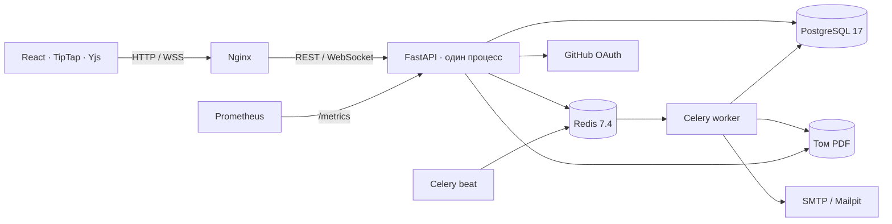

# Архитектура



Модульный монолит: API, worker и beat используют один Python-код. Роутеры
передают бизнес-операции сервисам. PostgreSQL — источник истины; Redis хранит
кэш ролей, одноразовые OAuth-коды и очереди. Комнаты живут только в одном
процессе API; масштабирование несколькими репликами не поддерживается.

## Редактирование

```mermaid
sequenceDiagram
  participant A as Браузер A
  participant API as FastAPI
  participant PG as PostgreSQL
  participant B as Браузер B
  A->>API: JWT, Origin, generation
  API->>PG: Документ и права
  API-->>A: Yjs sync
  A->>API: Бинарное обновление
  Note over API: Общая блокировка документа; роль; размер на копии
  API-->>B: Обновление Yjs
  API-->>A: status: unsaved
  Note over API: Debounce 2 с, максимум 10 с
  API->>PG: Состояние, revision + 1; commit
  API-->>A: status: saved
```

## Откат

```mermaid
sequenceDiagram
  participant A as Браузер
  participant API as FastAPI
  participant PG as PostgreSQL
  A->>API: POST restore
  Note over API: Блокировка документа, editor/owner
  API->>PG: Снапшот до отката + выбранное состояние
  API->>PG: generation + 1, revision + 1; commit
  API-->>A: Закрытие 4409
  A->>API: GET метаданных
  Note over A: Уничтожение старого Y.Doc
  A->>API: Подключение с новым generation
```

## Почему CRDT, а не OT

Yjs и pycrdt предоставляют совместимый готовый протокол сходимости.
Конкурентные изменения объединяются независимо от порядка доставки;
открытая вкладка может накопить правки во время краткого обрыва сети.
OT потребовал бы другого протокола преобразования операций и согласованной
серверной истории. CRDT не заменяет авторизацию и долговременное хранение:
эти обязанности остаются у API и PostgreSQL. Откат создаёт новое поколение,
а не объединяет старый снапшот с текущим состоянием.

Модель данных описана в [data-model.md](data-model.md).
