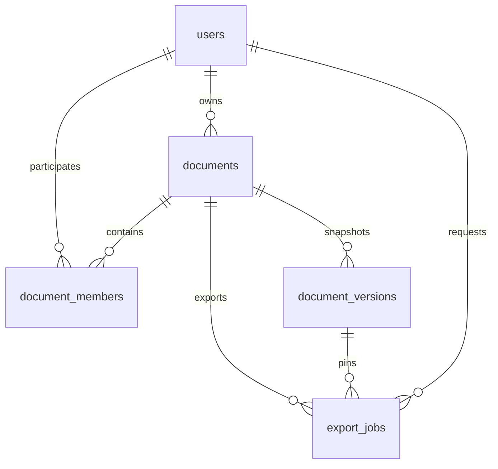

# Модель данных

UUID — идентификаторы; `timestamptz` — UTC. Схему создаёт Alembic.

| Таблица | Поля |
|---|---|
| users | id UUID PK; email varchar(254) UNIQUE; password_hash nullable; github_id nullable UNIQUE; display_name varchar(80); created_at timestamptz |
| documents | id UUID PK; owner_id FK users; title varchar(200); ydoc_state bytea; generation integer ≥1; state_revision integer ≥0; created_at, updated_at timestamptz |
| document_members | document_id, user_id: составной PK и FK; role editor/viewer |
| document_versions | id UUID PK; document_id FK; state bytea; source_revision ≥0; created_at; created_by nullable FK users; kind manual/scheduled/export |
| export_jobs | id UUID PK; document_id FK; requested_by FK users; version_id FK; status queued/running/succeeded/failed; relative_path, error_code nullable; created_at; finished_at nullable |

Пользователь имеет минимум один способ входа. Email нормализуется до записи.
Владелец хранится только в `documents.owner_id`; сервис запрещает добавлять
его в `document_members`. Название после trim имеет длину 1–200.

Составной внешний ключ экспорта `(document_id, version_id)` гарантирует,
что закреплённый снапшот принадлежит документу. Частичный уникальный индекс
`(document_id, source_revision) WHERE kind='scheduled'` предотвращает
повтор периодического снапшота. Удаление документа каскадно удаляет участников,
версии и задания; файлы удаляет периодическая очистка.
