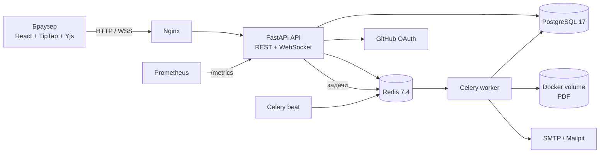
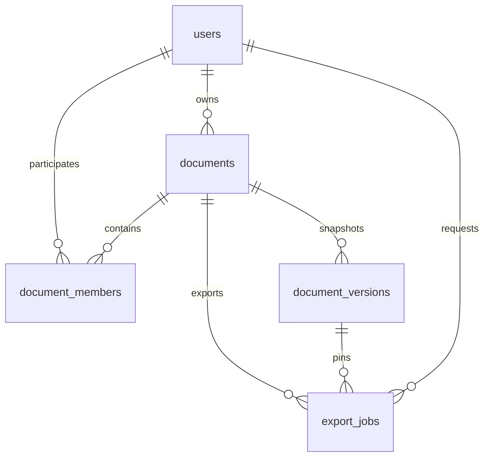

# Лист согласования

| Роль | Ф. И. О. | Подпись | Дата |
|---|---|---|---|
| Заказчик |  |  |  |
| Руководитель проекта |  |  |  |
| Ответственный разработчик |  |  |  |

## История редакций

| Версия | Дата | Изменение | Автор |
|---|---|---|---|
| 1.0 | 24.11.2026 | Согласованный состав функций, архитектура и порядок приёмки | Проектная команда |

# 1. Назначение документа

Настоящее техническое задание определяет состав, границы и правила реализации
учебного проекта **Cowrite** — веб-платформы для совместной работы с текстовыми
документами в реальном времени.

Документ используется как основание для разработки, ревью, тестирования и
демонстрации результата. Требования сформулированы так, чтобы по ним можно было
однозначно проверить готовое приложение. Описание конкретных библиотек и
внутренних механизмов не расширяет объём приёмки, если соответствующая функция
работает в соответствии с настоящим документом.

Проект рассчитан на небольшую учебную команду. Развёртывание выполняется в
Docker Compose. Рабочий сценарий ориентирован на современный настольный браузер;
отдельная сертификация всех браузеров и мобильных экранов в объём проекта не
входит.

# 2. Общие сведения о системе

## 2.1. Наименование и назначение

**Наименование:** Cowrite.

**Назначение:** создание, совместное редактирование, сохранение, просмотр
истории и экспорт текстовых документов в PDF.

Платформа решает задачу, которая обычно возникает при подготовке отчётов,
учебных материалов и рабочих заметок: несколько пользователей могут открыть один
документ и видеть изменения друг друга без ручной пересылки файлов. Доступ к
каждому документу контролируется отдельно.

## 2.2. Цели проекта

В результате разработки пользователь должен иметь возможность:

1. зарегистрироваться и войти в систему;
2. создать документ и открыть его в браузере;
3. предоставить другому зарегистрированному пользователю роль редактора или
   читателя;
4. одновременно редактировать текст с другим участником;
5. продолжить работу после краткого обрыва сети;
6. сохранить ручную или автоматическую версию документа;
7. восстановить документ по выбранной версии;
8. получить PDF-файл и скачать его при наличии права доступа.

## 2.3. Границы решения

В состав Cowrite входят браузерный интерфейс, HTTP API, WebSocket-канал
совместного редактирования, реляционная база данных, Redis, фоновые задачи,
почтовая интеграция, генерация PDF, автоматические проверки и сценарий
развёртывания.

В состав этой редакции **не входят**:

- импорт и экспорт DOCX, Markdown и других форматов, кроме PDF;
- изображения, таблицы, комментарии и встроенные вложения;
- публичные ссылки без входа в систему;
- восстановление пароля и управление списком активных сессий;
- передача владения документом;
- визуальное сравнение двух версий;
- редактирование закрытой вкладки в автономном режиме;
- микросервисная архитектура, Kubernetes, Helm, gRPC, Kafka и RabbitMQ;
- кластеризация API, PostgreSQL или Redis;
- отдельный нагрузочный стенд с нормативами p95 и фиксированным числом клиентов.

Изменение границ оформляется отдельным решением заказчика и не считается частью
приёмки без внесения в новую редакцию ТЗ.

# 3. Пользователи и права доступа

## 3.1. Учётная запись

Пользователь имеет уникальный адрес электронной почты, отображаемое имя и один
или несколько способов входа. В локальном варианте доступна регистрация по email
и паролю. Дополнительный способ — вход через GitHub OAuth.

Пароль не показывается и не хранится в исходном виде. В ответах API отсутствуют
хеш пароля и внутренние данные авторизации.

## 3.2. Роли в документе

Роль назначается отдельно для каждого документа.

| Роль | Назначение |
|---|---|
| **Владелец (owner)** | Полный контроль над документом, участниками, названием, версиями и экспортом |
| **Редактор (editor)** | Просмотр и изменение текста, просмотр и создание версий, восстановление и экспорт |
| **Читатель (viewer)** | Просмотр текста, курсоров и истории, экспорт без изменения документа |

Владелец хранится в поле документа и не дублируется в списке участников.
Участнику можно назначить только `editor` или `viewer`. Глобальной роли
администратора в системе нет.

## 3.3. Матрица доступа

| Операция | owner | editor | viewer |
|---|:---:|:---:|:---:|
| Открыть документ и увидеть курсоры | Да | Да | Да |
| Изменить текст и форматирование | Да | Да | Нет |
| Просмотреть список версий | Да | Да | Да |
| Создать ручную версию | Да | Да | Нет |
| Восстановить версию | Да | Да | Нет |
| Запустить и скачать PDF | Да | Да | Да |
| Переименовать документ | Да | Нет | Нет |
| Удалить документ | Да | Нет | Нет |
| Просмотреть участников | Да | Нет | Нет |
| Добавить, изменить или удалить участника | Да | Нет | Нет |

Проверка права выполняется на сервере для каждой операции. Скрытая или
заблокированная кнопка интерфейса не считается механизмом защиты.

# 4. Пользовательские сценарии

## 4.1. Регистрация и вход

Пользователь открывает приложение, выбирает регистрацию, указывает имя, email и
пароль, после чего получает доступ к списку документов. После обычного входа
сервер выдаёт JWT Bearer с временем действия 30 минут.

Второй вариант — кнопка «Войти через GitHub». Браузер проходит OAuth Authorization
Code flow, после чего сервер создаёт пользователя или находит существующего по
GitHub ID. JWT передаётся приложению через одноразовый код обмена, а не через URL.

Текущая реализация хранит access token только в памяти вкладки. После обновления
страницы требуется повторный вход; адрес открытого документа сохраняется, поэтому
после входа пользователь возвращается в тот же документ.

## 4.2. Работа с документами

После входа пользователь видит список собственных документов и документов, к
которым ему предоставлен доступ. В списке отображаются название, роль и дата
последнего изменения. Кнопка «Новый документ» создаёт пустой документ и открывает
его в редакторе.

Владелец может переименовать или удалить документ. Перед удалением интерфейс
запрашивает подтверждение. Удаление каскадно очищает связанные права, версии и
задания экспорта.

## 4.3. Совместное редактирование

Владелец открывает панель «Доступ», указывает email зарегистрированного
пользователя и назначает роль. После предоставления доступа второй пользователь
может открыть тот же документ.

Изменения текста и форматирования появляются у подключённых участников. В
редакторе отображаются курсоры и выделения. При кратком обрыве WebSocket клиент
пытается подключиться снова; открытый документ сохраняется в памяти вкладки до
восстановления связи.

## 4.4. История и восстановление

Владелец или редактор создаёт ручной снимок текущего состояния. Периодические
снимки создаются фоновым worker каждые пять минут, если документ изменился.

При восстановлении сервер сначала фиксирует текущее состояние как отдельную
версию, затем устанавливает выбранный снимок текущим. Активные соединения
закрываются с кодом 4409. Клиенты перечитывают поколение документа и создают
новый экземпляр редактора.

## 4.5. Экспорт

Пользователь с правом чтения открывает панель «PDF» и запускает экспорт. Сервер
закрепляет снимок документа, создаёт задание и сразу возвращает его идентификатор.
Worker формирует PDF в фоне. Интерфейс опрашивает состояние задания и показывает
кнопку скачивания после готовности файла.

# 5. Функциональные требования

## 5.1. Аутентификация

Система должна:

- принимать email длиной не более 254 символов;
- нормализовать email удалением крайних пробелов и приведением к нижнему регистру;
- принимать пароль длиной от 12 до 128 символов, сохраняя пробелы внутри;
- принимать отображаемое имя длиной от 1 до 80 символов после обрезки пробелов;
- хешировать пароль алгоритмом Argon2id;
- возвращать одинаковую ошибку 401 для неизвестного email и неверного пароля;
- возвращать 409 при повторной регистрации email;
- выдавать JWT с `sub`, `iat`, `exp`, `jti`, `iss` и `aud`;
- проверять алгоритм, издателя, аудиторию и срок действия токена;
- не включать пароль и его хеш в ответы API.

## 5.2. GitHub OAuth

Для входа через GitHub применяются настройки OAuth App: client ID, client secret,
callback URL и область `user:email`.

Поток состоит из следующих шагов:

1. `GET /auth/github/login` создаёт случайный `state`, связывает его с браузером
   и сохраняет в Redis на пять минут.
2. GitHub возвращает браузер на callback с параметром `code`.
3. Сервер проверяет `state`, получает профиль и подтверждённый основной email.
4. Пользователь ищется по `github_id`; при отсутствии создаётся новая запись.
5. При совпадении email с локальной учётной записью автоматическая привязка не
   выполняется и возвращается контролируемый конфликт.
6. Callback выдаёт одноразовый код на 60 секунд.
7. `POST /auth/exchange` меняет код на JWT.

GitHub access token не сохраняется в базе данных. Ошибки state, повторное
использование кода, отсутствие подтверждённого email и конфликт аккаунтов
проверяются тестами.

## 5.3. Документы

Название документа после обрезки пробелов имеет длину от 1 до 200 символов.
Если название не указано, используется «Без названия».

Список документов поддерживает пагинацию: `limit` от 1 до 100, по умолчанию 20,
и `offset` от 0. Сортировка выполняется по времени изменения от новых к старым,
затем по идентификатору.

Метаданные документа содержат идентификатор, название, владельца, роль текущего
пользователя, даты создания и изменения, поколение и ревизию сохранённого
состояния. Содержимое CRDT в обычные REST-ответы не включается.

## 5.4. Участники

Владелец может добавить только зарегистрированного пользователя по email. Повторное
добавление изменяет его роль. Удаление участника отзывает доступ и закрывает его
активные WebSocket-соединения. После изменения роли новое право применяется без
ожидания истечения кэша.

Изменение доступа сначала фиксируется в PostgreSQL. Уведомление отправляется
отдельной задачей. Ошибка SMTP не отменяет выданное право.

## 5.5. Редактор

В редакторе поддерживаются:

- обычный текст;
- жирное начертание;
- курсив;
- заголовки уровней 1–3;
- маркированный список;
- нумерованный список.

Редактор использует общий Yjs-документ с XML-фрагментом `default`. Права
определяются серверной ролью, а не именем или цветом курсора. Читатель получает
состояние документа и awareness, но его сообщения не изменяют текст.

## 5.6. Сохранение

При открытии комнаты состояние загружается из базы. Изменения записываются после
двух секунд бездействия; при непрерывном вводе максимальный интервал между
записями — десять секунд. После отключения последнего участника выполняется
немедленная запись.

Интерфейс различает состояния «Синхронизация», «Есть несохранённые изменения»,
«Сохранено», «Ошибка сохранения» и «Нет соединения». Статус «Сохранено» означает
успешный commit в PostgreSQL, а не только доставку изменения в комнату.

## 5.7. Версии

Версия хранит полный снимок CRDT, а не набор дельт. Для каждой версии сохраняются
документ, ревизия-источник, дата, инициатор и тип: `manual`, `scheduled` или
`export`.

Повторная доставка периодической задачи не создаёт второй снимок той же ревизии.
Старая версия после восстановления остаётся в истории. Визуальное сравнение
версий и автоматическое удаление истории не предусмотрены.

## 5.8. PDF

PDF формируется только worker из закреплённого снимка, созданного при постановке
задания. Формат страницы — A4, поля — 20 мм, основной шрифт — DejaVu Sans 11 pt.
Файл содержит название и текст документа, включая кириллицу, а также поддержанный
набор форматирования.

Файл записывается во временный путь и затем атомарно переименовывается. Доступ к
статусу и файлу проверяется для каждого запроса. Срок хранения — 24 часа; очистка
запускается периодической задачей.

# 6. Архитектура и состав компонентов

## 6.1. Общая схема

Cowrite реализован как модульный монолит. API, worker и beat используют одну
кодовую базу, но работают отдельными процессами. Активные комнаты CRDT находятся
в памяти одного процесса API; в учебной конфигурации используется одна реплика
API и один Uvicorn worker.



## 6.2. Компоненты

| Компонент | Ответственность |
|---|---|
| `frontend` | Сборка и раздача React-приложения; проксирование API и WebSocket |
| `api` | REST, авторизация, документы, WebSocket-комнаты и статусы сохранения |
| `worker` | Письма, снапшоты, PDF и очистка файлов |
| `beat` | Запуск периодических задач |
| `postgres` | Источник истины для пользователей, прав, документов и версий |
| `redis` | Кэш ролей, OAuth state, брокер и результаты Celery |
| `mailpit` | SMTP-приёмник для локальной проверки писем |
| `prometheus` | Сбор метрик API |
| `migrate` | Одноразовое применение миграций Alembic перед API и worker |

Маршрут `/api/` обслуживает REST, `/ws/` — WebSocket, остальные запросы передаются
фронтенду. В production внешний трафик проходит через Nginx по HTTPS/WSS.

## 6.3. Структура исходного кода

Серверная часть разделена на модули `auth`, `documents`, `collab`, `versions`,
`exports` и `notifications`. Внутри модулей роутер принимает и проверяет запрос,
сервис выполняет бизнес-операцию, схемы описывают обмен данными, модели описывают
хранение. SQL не размещается непосредственно в HTTP-роутерах.

Внешние операции выполняются асинхронно: SQLAlchemy AsyncSession, asyncpg,
httpx.AsyncClient и redis.asyncio. Генерация PDF и отправка почты выполняются вне
event loop API.

# 7. Модель данных

Все идентификаторы сущностей имеют тип UUID. Время хранится в UTC в типе
`timestamptz`. Состояние Yjs хранится как `bytea`.



| Таблица | Основные поля и ограничения |
|---|---|
| `users` | `id`, уникальный `email`, nullable `password_hash`, nullable уникальный `github_id`, `display_name`, `created_at` |
| `documents` | `id`, `owner_id`, `title`, `ydoc_state`, `generation >= 1`, `state_revision >= 0`, даты создания и изменения |
| `document_members` | Составной ключ `document_id + user_id`, роль `editor` или `viewer` |
| `document_versions` | `id`, документ, состояние, исходная ревизия, дата, создатель, тип версии |
| `export_jobs` | Документ, инициатор, закреплённая версия, статус, путь, код ошибки, даты |

Владелец не добавляется в `document_members`. Удаление документа каскадно удаляет
участников, версии и задания; PDF-файлы удаляются отдельной очисткой. Схема
создаётся миграциями Alembic, вызов ORM `create_all` при старте не используется.

# 8. Протокол совместной работы

## 8.1. Установление соединения

Сначала браузер получает `GET /documents/{id}` и читает поле `generation`. Затем
открывается соединение:

```text
/ws/documents/{id}?token={jwt}&generation={number}
```

Заголовок `Origin` должен соответствовать разрешённому списку. До обмена
сообщениями сервер проверяет JWT, существование документа, роль и поколение.

Второй WebSocket-канал:

```text
/ws/documents/{id}/status?token={jwt}&generation={number}
```

Он передаёт только серверные статусы сохранения и изменения роли.

## 8.2. Сообщения и ограничения

В основном канале используется протокол `y-websocket` / `y-protocols`, а не
произвольный JSON. Поддерживаются sync-сообщения и awareness-сообщения.

Ограничения текущей реализации:

- не более 10 CRDT-соединений на документ;
- не более 50 CRDT-соединений на API;
- размер сообщения не более 1 MiB;
- результирующее состояние документа не более 5 MiB;
- один канал статусов на CRDT-соединение.

При превышении размера используется код закрытия 1009. При истечении JWT сервер
закрывает соединение с кодом 4401. Остальные прикладные коды:

| Код | Значение |
|---:|---|
| 1000 | Нормальное завершение |
| 1003 | Неподдерживаемый формат |
| 1013 | Продолжительная ошибка сохранения |
| 4401 | Неверный или истёкший JWT |
| 4403 | Нет доступа или запрещённый Origin |
| 4404 | Документ удалён или не найден |
| 4409 | Подключение использует старое поколение |
| 4429 | Превышен лимит соединений |

## 8.3. Смена роли и поколение

При удалении участника его соединения закрываются. При понижении до viewer
изменения от клиента больше не применяются. Проверка роли выполняется при каждом
входящем изменении, поэтому одного долгоживущего подключения недостаточно для
сохранения старых прав.

Откат версии увеличивает `generation`. Все подключения старого поколения
закрываются. Клиент удаляет старый Y.Doc, заново получает метаданные и открывает
новое соединение. Изменения старого поколения не переносятся.

# 9. REST API

Ниже перечислены маршруты без внешнего префикса `/api`. Даты передаются в ISO
8601 UTC, идентификаторы — строками UUID. Точный JSON-контракт хранится в
`docs/openapi.json` и автоматически проверяется тестом контракта.

| Метод | Путь | Назначение | Успешный ответ |
|---|---|---|---:|
| `POST` | `/auth/register` | Регистрация | 201 |
| `POST` | `/auth/login` | Вход по паролю | 200 |
| `GET` | `/auth/github/login` | Начало OAuth | 302 |
| `GET` | `/auth/github/callback` | Callback OAuth | 302 |
| `POST` | `/auth/exchange` | Обмен одноразового кода | 200 |
| `GET` | `/users/me` | Текущий пользователь | 200 |
| `POST` | `/documents` | Создание документа | 201 |
| `GET` | `/documents` | Список доступных документов | 200 |
| `GET` | `/documents/{id}` | Метаданные документа | 200 |
| `PATCH` | `/documents/{id}` | Переименование | 200 |
| `DELETE` | `/documents/{id}` | Удаление | 204 |
| `GET` | `/documents/{id}/members` | Участники | 200 |
| `POST` | `/documents/{id}/members` | Добавление или смена роли | 200 |
| `DELETE` | `/documents/{id}/members/{user_id}` | Отзыв доступа | 204 |
| `GET` | `/documents/{id}/versions` | История | 200 |
| `POST` | `/documents/{id}/versions` | Ручной снимок | 201 |
| `POST` | `/documents/{id}/versions/{version_id}/restore` | Восстановление | 200 |
| `POST` | `/documents/{id}/export` | Запуск PDF | 202 |
| `GET` | `/exports/{task_id}` | Состояние задания | 200 |
| `GET` | `/exports/{task_id}/file` | Скачивание PDF | 200 |

Основные коды ошибок: 401 — отсутствует или недействителен токен; 403 — нет
права; 404 — объект или участник не найден; 409 — конфликт; 413 — слишком большое
тело; 422 — ошибка валидации; 429 — превышен лимит; 503 — обязательная зависимость
недоступна.

Ошибка содержит стабильный код и понятное сообщение в поле `detail`. Валидация
Pydantic возвращает 422. Доступ к существующему документу без членства возвращает
403, а не 404.

# 10. Внешние интеграции и фоновые задачи

## 10.1. GitHub

Интеграция используется только для аутентификации. Сервер не сохраняет GitHub
access token и не запрашивает лишние разрешения. В автоматических тестах ответы
GitHub заменяются `MockTransport`; живой OAuth требует настроенной OAuth App.

## 10.2. SMTP

После предоставления доступа Celery ставит задачу отправки приглашения. В задачу
передаются идентификаторы документа, получателя и пригласившего, но не пароли и не
токены. Worker повторно проверяет документ и членство перед отправкой.

В локальной среде используется Mailpit: SMTP-порт 1025, web-интерфейс 8025. В
production параметры SMTP задаются окружением; для внешнего сервера используется
STARTTLS. Повторы при временной ошибке выполняются через 10, 30 и 90 секунд.
Модель доставки — at-least-once.

## 10.3. Celery

Redis используется как брокер задач и хранилище результатов. Периодические задачи:

- снапшоты изменившихся документов — каждые 300 секунд;
- очистка PDF старше 24 часов — каждый час.

Отдельные задачи используются для приглашений и экспорта. При остановке worker
редактирование документа продолжается, а очередь сохраняется в Redis. Повторная
доставка не должна создавать второй результат для одного задания.

# 11. Безопасность и ограничения

В production HTTP и WebSocket доступны через Nginx по HTTPS/WSS. PostgreSQL и
Redis не публикуются во внешний интерфейс сервера. Разрешённые CORS и WebSocket
origin задаются явно.

JWT передаётся в заголовке Authorization для REST и в параметре WebSocket,
необходимом для handshake. Query-параметры с токеном не попадают в access-логи,
метрики и сообщения об ошибках. Пароли, токены, SMTP-секреты и содержимое
документов не записываются в журнал.

Для API действует ограничение 120 запросов в минуту на IP. Для регистрации,
входа и обмена OAuth-кода действует дополнительный лимит 10 запросов в минуту.
При превышении возвращается 429 с `Retry-After`. Размер HTTP-тела ограничен 1 MiB.

Входные данные SQL передаются через ORM и параметризованные запросы. Пользователь
не может задать путь сохранения PDF. При формировании PDF текст обрабатывается как
данные, а не как исполняемая разметка.

# 12. Наблюдаемость и отказоустойчивость

Сервис пишет структурированные JSON-логи в stdout. Каждому HTTP-запросу назначается
`request_id`, который возвращается заголовком `X-Request-ID` и передаётся в
фоновые задачи. В журнале сохраняются метод, статус и длительность; персональные
данные и содержимое документов исключены.

Системные endpoints:

| Endpoint | Назначение |
|---|---|
| `GET /health` | Совместимый ответ 200: `{"status":"ok"}` |
| `GET /health/live` | Проверка работоспособности процесса |
| `GET /health/ready` | Проверка PostgreSQL и Redis; 503 при недоступности |
| `GET /metrics` | Метрики HTTP, WebSocket и ошибок сохранения |

Redis хранит данные с AOF и политикой `noeviction`, но не является заменой
PostgreSQL. При недоступности Redis операции аутентификации и постановки фоновых
задач завершаются контролируемой ошибкой 503; операции, не требующие Redis, не
должны маскировать сбой ложным подтверждением.

При отказе PostgreSQL интерфейс показывает ошибку сохранения. Подтверждённые ранее
состояния остаются в базе и восстанавливаются после перезапуска API. Незаписанные
изменения, которые были только в памяти комнаты, гарантированно сохраняться не
могут.

# 13. Технологический стек

| Область | Технология |
|---|---|
| Backend | Python 3.13, FastAPI, Uvicorn |
| Валидация и настройки | Pydantic 2, pydantic-settings |
| База данных | PostgreSQL 17, SQLAlchemy 2 async, asyncpg |
| Миграции | Alembic |
| Кэш и очередь | Redis 7.4, Celery 5, Celery beat |
| Совместная работа | pycrdt, pycrdt-websocket, Yjs, y-websocket |
| Аутентификация | PyJWT, Argon2id через argon2-cffi |
| Почта | aiosmtplib, SMTP, Mailpit в development |
| PDF | ReportLab, DejaVu Sans |
| Frontend | React 19, TypeScript, Vite |
| Редактор | TipTap 3 |
| Proxy | Nginx |
| Тесты | pytest, pytest-asyncio, pytest-cov, Hypothesis, Playwright |
| Качество | Ruff, mypy, ESLint |
| Поставка | Docker Compose v2, GitHub Actions, GHCR, SSH |
| Метрики | structlog, Prometheus, prometheus-fastapi-instrumentator |

Версии зависимостей фиксируются в `backend/uv.lock` и
`frontend/package-lock.json`. CI устанавливает зависимости из lock-файлов.

# 14. Контейнеризация и развёртывание

## 14.1. Локальная среда

Для запуска требуется Docker с Docker Compose v2:

```bash
Copy-Item .env.example .env
docker compose up --build
```

Приложение открывается на `http://localhost:8080`. Прямой API доступен на
`http://localhost:8000`, Mailpit — на `http://localhost:8025`, Prometheus — на
`http://localhost:9090`.

PostgreSQL, Redis и каталог PDF используют именованные тома. Сервис `migrate`
запускается до API и worker. Таблицы не создаются автоматически при старте
приложения.

## 14.2. Production

Production-сборка использует образы backend и frontend, опубликованные в GHCR с
тегами SHA коммита и `latest`. На сервере Nginx принимает HTTPS, а внутренние
сервисы доступны только в Docker-сети. Перед обновлением выполняется резервная
копия PostgreSQL, после миграций проверяется readiness.

Секреты GitHub OAuth, JWT, SMTP и SSH хранятся в переменных окружения или secrets
GitHub Actions. В репозиторий попадает только `.env.example` с безопасными
значениями-заглушками.

# 15. Организация разработки и CI/CD

Изменения проходят через ветки и Pull Request. Для каждой задачи создаётся
отдельная ветка от рабочей интеграционной ветки; прямой push в защищённые ветки не
используется. PR содержит описание изменения, способ проверки и ссылку на
связанный пункт ТЗ. Обязателен review другим участником.

Коммиты оформляются на английском с префиксами `feat:`, `fix:`, `test:` или
`docs:`. В рабочем репозитории поддерживаются отдельные зоны ответственности
backend, frontend, тестов, инфраструктуры и документации; границы фиксируются в
PR, а не скрываются в одном большом неописанном изменении.

GitHub Actions выполняет:

1. backend: `uv sync --frozen`, Ruff, форматирование, mypy, pytest;
2. frontend: `npm ci`, ESLint, TypeScript, production build, npm audit;
3. Docker build: проверку Compose и сборку обоих образов;
4. browser: запуск Compose и Playwright-сценарии совместной работы.

PostgreSQL и Redis для CI поднимаются как service containers. GitHub и SMTP в
автоматических тестах заменяются заглушками; настоящий worker и Mailpit проходят
отдельную контейнерную проверку. Обязательный процент покрытия не устанавливается:
важны наличие тестов по уровням и прохождение проверок.

После успешного merge в `main` workflow публикует образы в GHCR и выполняет
развёртывание по SSH, если настроены secrets и production environment.

# 16. Требования к тестированию

## 16.1. Unit-тесты

Проверяются хеширование и JWT, схема входных данных, матрица ролей, модели,
структурированные логи, кэширование, обработка CRDT и подготовка PDF.

## 16.2. Интеграционные тесты

Проверяются миграции и ограничения PostgreSQL, Redis TTL и инвалидация прав,
работа Celery с Redis, запись PDF в общий каталог, повторная доставка и письмо в
Mailpit.

## 16.3. API-тесты

Проверяются регистрация, вход, OAuth с mock-ответами, CRUD документов, участники,
все роли, история, восстановление, экспорт, форматы ошибок и ограничения тела.
Для защищённых операций проверяются 401, 403, 404 и 422 там, где это применимо.

## 16.4. WebSocket и браузер

Сценарии должны подтверждать:

- сходимость правки двух независимых клиентов;
- видимость курсоров и awareness;
- запрет изменения для viewer;
- применение изменения роли без повторного входа;
- восстановление после краткого обрыва;
- закрытие старого поколения при откате;
- постановку и получение PDF;
- появление приглашения в Mailpit.

Два клиента запускаются в разных браузерных контекстах, чтобы не разделять
cookies, хранилище и состояние вкладки.

# 17. Порядок приёмки

Работа считается готовой после выполнения всех пунктов:

1. `docker compose up --build` запускает приложение без ручного создания таблиц.
2. `/health`, `/health/live` и `/health/ready` возвращают предусмотренные ответы.
3. Новый пользователь регистрируется, входит и видит список документов.
4. Создатель создаёт документ, переименовывает его и удаляет тестовый документ.
5. Второй пользователь получает роль editor и редактирует документ одновременно
   с владельцем.
6. Пользователь с ролью viewer видит текст, но не может изменить его ни через
   интерфейс, ни через WebSocket-сообщение.
7. Приглашение появляется в Mailpit, а ошибка SMTP не отменяет доступ.
8. Ручная и автоматическая версии отображаются в истории.
9. После восстановления обе открытые вкладки переходят на новое поколение и
   показывают сохранённый текст.
10. PDF создаётся worker, содержит кириллицу и скачивается пользователем с правом
    доступа.
11. Пользователь без права получает 403, несуществующий объект — 404,
    невалидные данные — 422.
12. Перезапуск API не удаляет подтверждённое состояние документа.
13. Линтеры, типизация, тесты, Docker build и браузерные проверки проходят в CI.
14. Репозиторий содержит README, OpenAPI, описание WebSocket, архитектуру,
    модель данных и настоящее ТЗ.

## 17.1. Демонстрационный сценарий

Для показа результата регистрируются два пользователя. Первый создаёт документ
«План проекта» и выдаёт второму роль редактора. Оба открывают документ в отдельных
окнах, вносят текст и форматирование. Первый создаёт версию, затем меняет текст и
выполняет восстановление. После проверки нового состояния создаётся PDF. В конце
показываются Mailpit, Swagger UI, healthcheck и успешный CI.

# 18. Комплект поставки

В репозитории должны находиться:

| Файл или каталог | Содержание |
|---|---|
| `backend/` | FastAPI, модули, миграции, worker и тесты |
| `frontend/` | React-приложение и Playwright-сценарии |
| `docker-compose.yml` | Локальная инфраструктура |
| `docker-compose.prod.yml` | Production-описание с образами |
| `.github/workflows/` | CI и release/deploy workflow |
| `docs/technical-specification.md` | Исходная редакция ТЗ |
| `docs/ТЗ-Cowrite.docx` | Оформленная Word-копия ТЗ |
| `docs/architecture.md` | Схема компонентов и последовательности |
| `docs/data-model.md` | Сущности, связи и ограничения |
| `docs/websocket.md` | Handshake, сообщения, статусы и коды закрытия |
| `docs/openapi.json` | Контракт REST API |
| `docs/user-guide.md` | Инструкция по ручному сценарию |
| `docs/requirements.md` | Соответствие учебным требованиям и проверкам |
| `README.md` | Запуск, переменные, тесты и поставка |
| `.env.example` | Пример конфигурации без рабочих секретов |

# 19. Риски и принятые ограничения

1. Комнаты хранятся в памяти одного процесса API. Поэтому горизонтальное
   масштабирование API в этой версии не поддерживается.
2. Изменение, не успевшее попасть в PostgreSQL до аварийной остановки процесса,
   может быть потеряно. Интерфейс не должен показывать его сохранённым.
3. Доставка почты выполняется по модели at-least-once; повторное письмо возможно.
4. JWT не отзывается на сервере до естественного истечения срока действия.
5. Работа после закрытия вкладки в offline-режиме не гарантируется.
6. Настоящий GitHub OAuth и production-деплой требуют внешних ключей, домена и
   сервера. Автоматические проверки без этих секретов используют mock и локальные
   сервисы.

Перечисленные ограничения относятся к выбранному учебному объёму и не являются
дефектами при выполнении описанных сценариев.

# 20. Связь с исходными учебными требованиями

| Требование | Реализация в Cowrite |
|---|---|
| Модульная архитектура | Модули FastAPI и отдельные процессы worker/beat |
| Внешние интеграции | GitHub OAuth и SMTP; PostgreSQL/Redis — инфраструктурные зависимости |
| Асинхронность и очередь | Async API, Celery и Redis |
| Кэш и фоновые задачи | Кэш ролей, OAuth state, снапшоты, приглашения и PDF |
| Аутентификация и роли | JWT, Argon2id, owner/editor/viewer |
| Тестирование | Unit, integration, API, WebSocket и Playwright |
| CI/CD | GitHub Actions, сборка образов, GHCR и SSH-деплой |
| Контейнеризация | Docker Compose с API, worker, БД, Redis и frontend |
| Наблюдаемость | JSON-логи, request ID, Prometheus, live/ready healthcheck |
| Документация | README, OpenAPI, архитектура, модель данных, пользовательское руководство и ТЗ |
| Code review | Изменения проходят через Pull Request и проверяются CI |

# 21. Приложение А. Матрица приёмочных проверок

| № | Проверка | Действия | Ожидаемый результат |
|---:|---|---|---|
| 1 | Запуск | Выполнить `docker compose up --build` | Все обязательные сервисы проходят healthcheck; API и интерфейс открываются |
| 2 | Регистрация | Создать пользователя с корректными данными | Возвращается 201, после входа открывается список документов |
| 3 | Ошибка входа | Ввести правильный email с неверным паролем | Возвращается 401 без раскрытия существования учётной записи |
| 4 | Создание документа | Нажать «Новый документ» | Появляется документ «Без названия» с ролью owner |
| 5 | Пагинация | Создать более 20 документов и перейти на следующую страницу | Список разделён на страницы без повторов и пропусков |
| 6 | Редактирование | Ввести текст и применить жирное начертание, курсив, заголовок и список | Форматирование отображается в редакторе и сохраняется |
| 7 | Два клиента | Открыть документ в двух независимых браузерных контекстах и внести правки | Оба клиента получают единое состояние без ручного обновления |
| 8 | Viewer | Подключиться пользователем с ролью viewer и отправить изменение | Состояние доступно для чтения, изменение документа не применяется |
| 9 | Смена роли | Понизить editor до viewer при открытой вкладке | Новые изменения старой роли отклоняются, соединение обновляет состояние |
| 10 | Отзыв доступа | Удалить участника из панели владельца | Доступ прекращается, WebSocket закрывается с кодом 4403 |
| 11 | Автосохранение | Внести изменение и дождаться статуса «Сохранено» | Состояние подтверждено commit в PostgreSQL |
| 12 | Переподключение | Временно отключить сеть и вернуть её до закрытия вкладки | WebSocket подключается снова, изменения синхронизируются |
| 13 | Ручная версия | Нажать «Сохранить версию» | В истории появляется снимок с типом manual и текущей ревизией |
| 14 | Откат | Изменить документ, выбрать старую версию и подтвердить | Клиенты получают 4409, новый редактор показывает выбранное состояние |
| 15 | Периодическая версия | Изменить документ и выполнить задачу worker/beat | В истории появляется один scheduled-снимок изменившейся ревизии |
| 16 | Приглашение | Выдать доступ зарегистрированному пользователю | Роль сохранена, письмо с ссылкой появляется в Mailpit |
| 17 | PDF | Запустить экспорт, дождаться готовности и скачать файл | PDF содержит название, текст и кириллицу; доступ проверяется сервером |
| 18 | Ограничение доступа к PDF | Запросить чужой `task_id` или файл после отзыва роли | Сервер возвращает 403, а не выдаёт файл |
| 19 | Сбои зависимостей | Остановить Redis или PostgreSQL и проверить readiness | `/health/ready` возвращает 503; интерфейс не показывает ложное сохранение |
| 20 | Перезапуск API | Перезапустить API после статуса «Сохранено» | Документ открывается с последним подтверждённым состоянием |
| 21 | Контракт | Выполнить unit, integration, API и browser-тесты | Все обязательные проверки CI завершаются успешно |

При обнаружении расхождения сначала фиксируется фактический запрос, ответ или
состояние интерфейса, затем он сопоставляется с настоящим ТЗ и OpenAPI-контрактом.
Ручная проверка не заменяет автоматический тест для воспроизводимого дефекта.

# 22. Приложение Б. Конфигурация и внешние зависимости

## Б.1. Переменные окружения

| Переменная | Назначение | Требование к значению |
|---|---|---|
| `DATABASE_URL` | Подключение API и worker к PostgreSQL | Async DSN; production-секреты не коммитятся |
| `REDIS_CACHE_URL` | Кэш ролей и readiness | Redis DSN с отдельной логической БД |
| `CELERY_BROKER_URL` | Очередь Celery | Redis DSN для брокера |
| `CELERY_RESULT_BACKEND` | Результаты фоновых задач | Redis DSN для результатов |
| `JWT_SECRET` | Подпись access token | Не менее 32 случайных байт |
| `GITHUB_CLIENT_ID` | Идентификатор OAuth App | Заполняется для живого OAuth |
| `GITHUB_CLIENT_SECRET` | Секрет OAuth App | Хранится только в окружении |
| `GITHUB_REDIRECT_URI` | Точный callback GitHub | Должен совпадать с настройкой App |
| `FRONTEND_URL` | Origin приложения и ссылки из писем | URL без пути и учётных данных |
| `ALLOWED_ORIGINS` | CORS и проверка Origin WebSocket | Только доверенные origin |
| `SMTP_HOST`, `SMTP_PORT` | Почтовый сервер | В development — Mailpit: 1025 |
| `SMTP_USERNAME`, `SMTP_PASSWORD` | Авторизация SMTP | Не заполняются для локального Mailpit |
| `SMTP_FROM` | Адрес отправителя | Адрес, разрешённый почтовым сервером |
| `SMTP_STARTTLS` | Защита SMTP-соединения | В production включается для внешнего SMTP |
| `EXPORTS_DIR` | Каталог временных и готовых PDF | Общий volume API и worker |
| `LOG_LEVEL` | Уровень структурированных логов | Обычно `INFO` |

`.env.example` содержит безопасные локальные значения. Перед production-запуском
секреты, callback URL, SMTP и origin заменяются на значения конкретной среды.

## Б.2. Внешние сервисы и замены в тестах

| Сервис | Рабочая среда | Автоматические проверки |
|---|---|---|
| GitHub OAuth | Настроенная OAuth App | `httpx.MockTransport` и тестовые профили |
| SMTP | Mailpit локально или внешний SMTP | Заглушка `aiosmtplib`, отдельная проверка Mailpit |
| PostgreSQL | Docker service/Compose | Отдельная база с суффиксом `_test` |
| Redis | Docker service/Compose | Отдельные ключи и логические базы |
| Browser | Современный настольный браузер | Playwright Chromium в CI |

Production-интеграции не вызываются из unit-тестов. Если функция зависит от
секрета или доступного сервера, в тесте проверяется контракт, обработка ошибки и
безопасное поведение при недоступности зависимости.

## Б.3. Связанные документы

Настоящее ТЗ используется вместе со следующими файлами репозитория:

- `README.md` — запуск, разработка и поставка;
- `docs/architecture.md` — диаграммы компонентов и сценариев;
- `docs/data-model.md` — таблицы и ограничения базы данных;
- `docs/websocket.md` — детали handshake и бинарного протокола;
- `docs/openapi.json` — машинно читаемый REST-контракт;
- `docs/user-guide.md` — пошаговая инструкция для пользователя;
- `docs/requirements.md` — карта соответствия требований реализации;
- `TASKS.md` — порядок выполнения задач командой.

При расхождении приоритет имеют утверждённая редакция ТЗ, фактические правила
приёмки и согласованные изменения; технические справочники уточняют детали
реализации и не отменяют функциональные требования этого документа.
