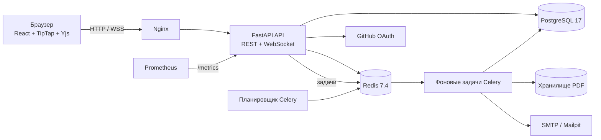
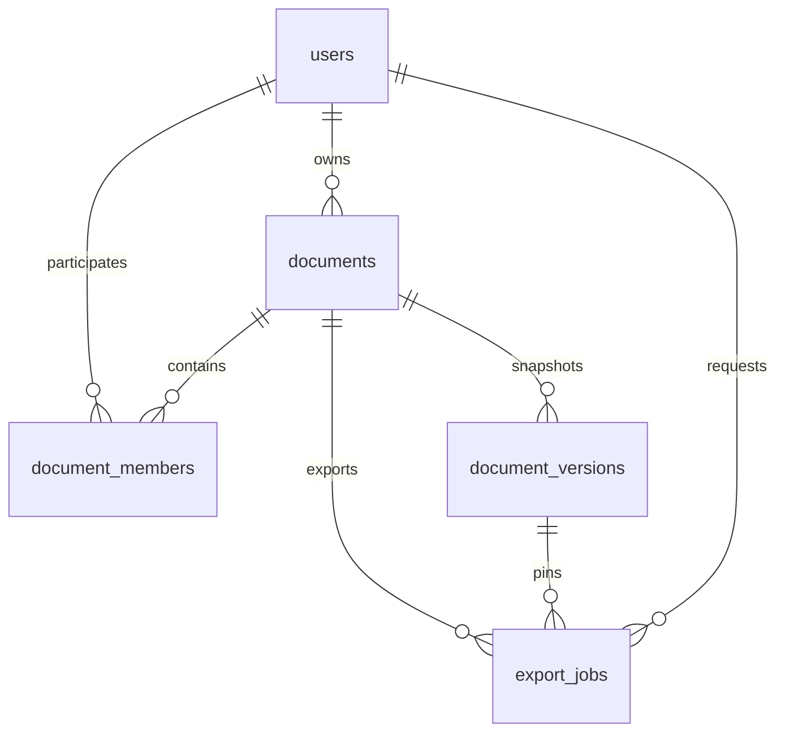

# Лист согласования

| Роль | Ф. И. О. | Подпись | Дата |
|---|---|---|---|
| Заказчик |  |  |  |
| Руководитель проекта |  |  |  |
| Ответственный разработчик |  |  |  |

## История редакций

| Версия | Дата | Изменение | Автор |
|---|---|---|---|
| 1.0 | 24.11.2026 | Согласованный состав функций, архитектура и порядок приёмки | Проектная команда |

# 1. Назначение документа

Настоящее техническое задание определяет состав, границы и правила реализации
учебного проекта **Cowrite** — веб-платформы для совместной работы с текстовыми
документами в реальном времени.

Документ определяет, что нужно разработать и как проверить результат.
Названия библиотек и внутренние решения приведены для пояснения архитектуры.

Проект рассчитан на небольшую учебную команду. Приложение запускается через
Docker Compose и работает в современном браузере на компьютере.

# 2. Общие сведения о системе

## 2.1. Наименование и назначение

**Наименование:** Cowrite.

**Назначение:** создание, совместное редактирование, сохранение, просмотр
истории и экспорт текстовых документов в PDF.

Платформа решает задачу, которая обычно возникает при подготовке отчётов,
учебных материалов и рабочих заметок: несколько пользователей могут открыть один
документ и видеть изменения друг друга без ручной пересылки файлов. Доступ к
каждому документу контролируется отдельно.

## 2.2. Цели проекта

В результате разработки пользователь должен иметь возможность:

1. зарегистрироваться и войти в систему;
2. создать документ и открыть его в браузере;
3. предоставить другому зарегистрированному пользователю роль редактора или
   читателя;
4. одновременно редактировать текст с другим участником;
5. продолжить работу после краткого обрыва сети;
6. сохранить ручную или автоматическую версию документа;
7. восстановить документ по выбранной версии;
8. получить PDF-файл и скачать его при наличии права доступа.

## 2.3. Границы решения

В состав Cowrite входят браузерный интерфейс, HTTP API, WebSocket-канал
совместного редактирования, реляционная база данных, Redis, фоновые задачи,
почтовая интеграция, генерация PDF, автоматические проверки и сценарий
развёртывания.

В состав этой редакции **не входят**:

- импорт и экспорт DOCX, Markdown и других форматов, кроме PDF;
- изображения, таблицы, комментарии и встроенные вложения;
- публичные ссылки без входа в систему;
- восстановление пароля и управление списком активных сессий;
- передача владения документом;
- визуальное сравнение двух версий;
- редактирование закрытой вкладки в автономном режиме;
- распределённое размещение на нескольких серверах;
- отдельные нагрузочные испытания.

Изменение границ оформляется отдельным решением заказчика и не считается частью
приёмки без внесения в новую редакцию ТЗ.

# 3. Пользователи и права доступа

## 3.1. Учётная запись

Пользователь имеет уникальный адрес электронной почты, отображаемое имя и один
или несколько способов входа. Доступна регистрация по электронной почте
и паролю. Дополнительный способ — вход через GitHub.

Пароль не показывается и не хранится в исходном виде. В ответах API отсутствуют
хеш пароля и внутренние данные авторизации.

## 3.2. Роли в документе

Роль назначается отдельно для каждого документа.

| Роль | Назначение |
|---|---|
| **Владелец** | Полный контроль над документом, участниками, названием, версиями и экспортом |
| **Редактор** | Просмотр и изменение текста, просмотр и создание версий, восстановление и экспорт |
| **Читатель** | Просмотр текста, курсоров и истории, экспорт без изменения документа |

Владелец хранится в поле документа и не дублируется в списке участников.
Участнику можно назначить только роль `editor` или `viewer`. Глобальной роли
администратора в системе нет.

## 3.3. Матрица доступа

| Операция | Владелец | Редактор | Читатель |
|---|:---:|:---:|:---:|
| Открыть документ и увидеть курсоры | Да | Да | Да |
| Изменить текст и форматирование | Да | Да | Нет |
| Просмотреть список версий | Да | Да | Да |
| Создать ручную версию | Да | Да | Нет |
| Восстановить версию | Да | Да | Нет |
| Запустить и скачать PDF | Да | Да | Да |
| Переименовать документ | Да | Нет | Нет |
| Удалить документ | Да | Нет | Нет |
| Просмотреть участников | Да | Нет | Нет |
| Добавить, изменить или удалить участника | Да | Нет | Нет |

Проверка права выполняется на сервере для каждой операции. Скрытая или
заблокированная кнопка интерфейса не считается механизмом защиты.

# 4. Пользовательские сценарии

## 4.1. Регистрация и вход

Пользователь открывает приложение, выбирает регистрацию, указывает имя, адрес почты и
пароль, после чего получает доступ к списку документов. После обычного входа
сервер выдаёт токен JWT со сроком действия 30 минут.

Второй вариант — кнопка «Войти через GitHub». Пользователь подтверждает вход
на сайте GitHub. Сервер находит его учётную запись или создаёт новую.
Приложение получает JWT через одноразовый код обмена, а не в адресе страницы.

Текущая реализация хранит токен доступа только в памяти вкладки. После обновления
страницы требуется повторный вход; адрес открытого документа сохраняется, поэтому
после входа пользователь возвращается в тот же документ.

## 4.2. Работа с документами

После входа пользователь видит список собственных документов и документов, к
которым ему предоставлен доступ. В списке отображаются название, роль и дата
последнего изменения. Кнопка «Новый документ» создаёт пустой документ и открывает
его в редакторе.

Владелец может переименовать или удалить документ. Перед удалением интерфейс
запрашивает подтверждение. Удаление каскадно очищает связанные права, версии и
задания экспорта.

## 4.3. Совместное редактирование

Владелец открывает панель «Доступ», указывает адрес электронной почты зарегистрированного
пользователя и назначает роль. После предоставления доступа второй пользователь
может открыть тот же документ.

Изменения текста и форматирования появляются у подключённых участников. В
редакторе отображаются курсоры и выделения. При кратком обрыве WebSocket клиент
пытается подключиться снова; открытый документ сохраняется в памяти вкладки до
восстановления связи.

## 4.4. История и восстановление

Владелец или редактор создаёт ручной снимок текущего состояния. Периодические
снимки создаются фоновым процессом каждые пять минут, если документ изменился.

При восстановлении сервер сначала фиксирует текущее состояние как отдельную
версию, затем устанавливает выбранный снимок текущим. Активные соединения
закрываются с кодом 4409. Клиенты перечитывают поколение документа и создают
новый экземпляр редактора.

## 4.5. Экспорт

Пользователь с правом чтения открывает панель «PDF» и запускает экспорт. Сервер
закрепляет снимок документа, создаёт задание и сразу возвращает его идентификатор.
Фоновый процесс формирует PDF. Интерфейс проверяет состояние задания и показывает
кнопку скачивания после готовности файла.

# 5. Функциональные требования

## 5.1. Регистрация и проверка входа

Система должна:

- принимать адрес электронной почты длиной не более 254 символов;
- нормализовать адрес электронной почты удалением крайних пробелов и приведением к нижнему регистру;
- принимать пароль длиной от 12 до 128 символов, сохраняя пробелы внутри;
- принимать отображаемое имя длиной от 1 до 80 символов после обрезки пробелов;
- хешировать пароль алгоритмом Argon2id;
- возвращать одинаковую ошибку 401 для неизвестного адреса почты и неверного пароля;
- возвращать 409 при повторной регистрации адреса почты;
- выдавать JWT с `sub`, `iat`, `exp`, `jti`, `iss` и `aud`;
- проверять алгоритм, издателя, аудиторию и срок действия токена;
- не включать пароль и его хеш в ответы API.

## 5.2. Вход через GitHub

Для входа через GitHub нужны идентификатор приложения, секретный ключ,
адрес возврата в Cowrite и разрешение `user:email`.

Поток состоит из следующих шагов:

1. `GET /auth/github/login` создаёт случайный `state`, связывает его с браузером
   и сохраняет в Redis на пять минут.
2. GitHub возвращает браузер в Cowrite с параметром `code`.
3. Сервер проверяет `state`, получает профиль и подтверждённый основной адрес электронной почты.
4. Пользователь ищется по `github_id`; при отсутствии создаётся новая запись.
5. При совпадении адреса электронной почты с локальной учётной записью автоматическая привязка не
   выполняется и возвращается контролируемый конфликт.
6. Сервер выдаёт одноразовый код на 60 секунд.
7. `POST /auth/exchange` меняет код на JWT.

Токен доступа GitHub не сохраняется в базе данных. Неверный `state`, повторное
использование кода, отсутствие подтверждённого адреса электронной почты и конфликт аккаунтов
проверяются тестами.

## 5.3. Документы

Название документа после обрезки пробелов имеет длину от 1 до 200 символов.
Если название не указано, используется «Без названия».

Список документов разбивается на страницы: `limit` от 1 до 100, по умолчанию 20,
и `offset` от 0. Сортировка выполняется по времени изменения от новых к старым,
затем по идентификатору.

Метаданные документа содержат идентификатор, название, владельца, роль текущего
пользователя, даты создания и изменения, поколение и ревизию сохранённого
состояния. Содержимое CRDT в обычные REST-ответы не включается.

## 5.4. Участники

Владелец может добавить только зарегистрированного пользователя по адресу электронной почты. Повторное
добавление изменяет его роль. Удаление участника отзывает доступ и закрывает его
активные WebSocket-соединения. После изменения роли новое право применяется без
ожидания истечения кэша.

Изменение доступа сначала фиксируется в PostgreSQL. Уведомление отправляется
отдельной задачей. Ошибка SMTP не отменяет выданное право.

## 5.5. Редактор

В редакторе поддерживаются:

- обычный текст;
- жирное начертание;
- курсив;
- заголовки уровней 1–3;
- маркированный список;
- нумерованный список.

Редактор использует общий Yjs-документ с XML-фрагментом `default`. Права
определяются серверной ролью, а не именем или цветом курсора. Читатель получает
состояние документа и сведения о курсорах участников, но не может изменить текст.

## 5.6. Сохранение

При открытии комнаты состояние загружается из базы. Изменения записываются после
двух секунд бездействия; при непрерывном вводе максимальный интервал между
записями — десять секунд. После отключения последнего участника выполняется
немедленная запись.

Интерфейс различает состояния «Синхронизация», «Есть несохранённые изменения»,
«Сохранено», «Ошибка сохранения» и «Нет соединения». Статус «Сохранено» означает
успешную запись в PostgreSQL, а не только передачу изменения серверу.

## 5.7. Версии

Версия хранит полный снимок CRDT, а не отдельные изменения. Для каждой версии сохраняются
документ, исходная ревизия, дата, инициатор и тип: ручной (`manual`), автоматический
(`scheduled`) или созданный для PDF (`export`).

Повторная доставка периодической задачи не создаёт второй снимок той же ревизии.
Старая версия после восстановления остаётся в истории. Визуальное сравнение
версий и автоматическое удаление истории не предусмотрены.

## 5.8. PDF

PDF формируется фоновым процессом из снимка, созданного при постановке
задания. Формат страницы — A4, поля — 20 мм, основной шрифт — DejaVu Sans 11 pt.
Файл содержит название и текст документа, включая кириллицу, а также поддержанный
набор форматирования.

Файл записывается во временный путь и затем атомарно переименовывается. Доступ к
статусу и файлу проверяется для каждого запроса. Срок хранения — 24 часа; очистка
запускается периодической задачей.

# 6. Архитектура и состав компонентов

## 6.1. Общая схема

Cowrite реализован как модульный монолит. API, фоновый процесс и планировщик используют одну
кодовую базу, но работают отдельными процессами. Активные комнаты CRDT находятся
в памяти одного процесса API; в учебной конфигурации используется одна реплика
API с одним процессом Uvicorn.



## 6.2. Компоненты

| Компонент | Ответственность |
|---|---|
| `frontend` | Сборка и раздача приложения React; передача запросов к API и WebSocket |
| `api` | REST, авторизация, документы, WebSocket-комнаты и статусы сохранения |
| `worker` | Отправка писем, создание снимков, PDF и очистка файлов |
| `beat` | Запуск задач по расписанию |
| `postgres` | Основное хранилище пользователей, прав, документов и версий |
| `redis` | Кэш прав, временные данные входа через GitHub, очередь и результаты задач |
| `mailpit` | SMTP-приёмник для локальной проверки писем |
| `prometheus` | Сбор метрик API |
| `migrate` | Обновление схемы базы через Alembic перед запуском API и фонового процесса |

Маршрут `/api/` обслуживает REST, `/ws/` — WebSocket, остальные запросы передаются
клиентской части. На рабочем сервере соединения проходят через Nginx по HTTPS/WSS.

## 6.3. Структура исходного кода

Серверная часть разделена на модули `auth`, `documents`, `collab`, `versions`,
`exports` и `notifications`. Внутри модулей обработчик принимает и проверяет запрос,
сервис выполняет бизнес-операцию, схемы описывают обмен данными, модели описывают
хранение. SQL не размещается непосредственно в обработчиках HTTP-запросов.

Внешние операции выполняются асинхронно: SQLAlchemy AsyncSession, asyncpg,
httpx.AsyncClient и redis.asyncio. Создание PDF и отправка почты не блокируют API.

# 7. Модель данных

Все идентификаторы сущностей имеют тип UUID. Время хранится в UTC в типе
`timestamptz`. Состояние Yjs хранится как `bytea`.



| Таблица | Основные поля и ограничения |
|---|---|
| `users` | `id`, уникальный `email`, необязательные `password_hash` и уникальный `github_id`, `display_name`, `created_at` |
| `documents` | `id`, `owner_id`, `title`, `ydoc_state`, `generation >= 1`, `state_revision >= 0`, даты создания и изменения |
| `document_members` | Составной ключ `document_id + user_id`, роль `editor` или `viewer` |
| `document_versions` | `id`, документ, состояние, исходная ревизия, дата, создатель, тип версии |
| `export_jobs` | Документ, инициатор, закреплённая версия, статус, путь, код ошибки, даты |

Владелец не добавляется в `document_members`. Удаление документа каскадно удаляет
участников, версии и задания; PDF-файлы удаляются отдельной очисткой. Схема
создаётся миграциями Alembic, вызов ORM `create_all` при старте не используется.

# 8. Протокол совместной работы

## 8.1. Установление соединения

Сначала браузер получает `GET /documents/{id}` и читает поле `generation`. Затем
открывается соединение:

```text
/ws/documents/{id}?token={jwt}&generation={number}
```

Заголовок `Origin` должен соответствовать разрешённому списку. До обмена
сообщениями сервер проверяет JWT, существование документа, роль и поколение.

Второй WebSocket-канал:

```text
/ws/documents/{id}/status?token={jwt}&generation={number}
```

Он передаёт только серверные статусы сохранения и изменения роли.

## 8.2. Сообщения и ограничения

В основном канале используется протокол `y-websocket` / `y-protocols`, а не
произвольный JSON. Передаются изменения документа и сведения о курсорах участников.

Ограничения текущей реализации:

- не более 10 CRDT-соединений на документ;
- не более 50 CRDT-соединений на API;
- размер сообщения не более 1 MiB;
- результирующее состояние документа не более 5 MiB;
- один канал статусов на CRDT-соединение.

При превышении размера используется код закрытия 1009. При истечении JWT сервер
закрывает соединение с кодом 4401. Остальные прикладные коды:

| Код | Значение |
|---:|---|
| 1000 | Нормальное завершение |
| 1003 | Неподдерживаемый формат |
| 1013 | Продолжительная ошибка сохранения |
| 4401 | Неверный или истёкший JWT |
| 4403 | Нет доступа или подключение с запрещённого адреса |
| 4404 | Документ удалён или не найден |
| 4409 | Подключение использует старое поколение |
| 4429 | Превышен лимит соединений |

## 8.3. Смена роли и поколение

При удалении участника его соединения закрываются. При смене роли на читателя
изменения от клиента больше не применяются. Проверка роли выполняется при каждом
входящем изменении, поэтому одного долгоживущего подключения недостаточно для
сохранения старых прав.

Откат версии увеличивает `generation`. Все подключения старого поколения
закрываются. Клиент удаляет старый Y.Doc, заново получает метаданные и открывает
новое соединение. Изменения старого поколения не переносятся.

# 9. REST API

Ниже перечислены маршруты без внешнего префикса `/api`. Даты передаются в ISO
8601 UTC, идентификаторы — строками UUID. Точный JSON-контракт хранится в
`docs/openapi.json` и автоматически проверяется тестом контракта.

| Метод | Путь | Назначение | Успешный ответ |
|---|---|---|---:|
| `POST` | `/auth/register` | Регистрация | 201 |
| `POST` | `/auth/login` | Вход по паролю | 200 |
| `GET` | `/auth/github/login` | Начало OAuth | 302 |
| `GET` | `/auth/github/callback` | Возврат после входа через GitHub | 302 |
| `POST` | `/auth/exchange` | Обмен одноразового кода | 200 |
| `GET` | `/users/me` | Текущий пользователь | 200 |
| `POST` | `/documents` | Создание документа | 201 |
| `GET` | `/documents` | Список доступных документов | 200 |
| `GET` | `/documents/{id}` | Метаданные документа | 200 |
| `PATCH` | `/documents/{id}` | Переименование | 200 |
| `DELETE` | `/documents/{id}` | Удаление | 204 |
| `GET` | `/documents/{id}/members` | Участники | 200 |
| `POST` | `/documents/{id}/members` | Добавление или смена роли | 200 |
| `DELETE` | `/documents/{id}/members/{user_id}` | Отзыв доступа | 204 |
| `GET` | `/documents/{id}/versions` | История | 200 |
| `POST` | `/documents/{id}/versions` | Ручной снимок | 201 |
| `POST` | `/documents/{id}/versions/{version_id}/restore` | Восстановление | 200 |
| `POST` | `/documents/{id}/export` | Запуск PDF | 202 |
| `GET` | `/exports/{task_id}` | Состояние задания | 200 |
| `GET` | `/exports/{task_id}/file` | Скачивание PDF | 200 |

Основные коды ошибок: 401 — отсутствует или недействителен токен; 403 — нет
права; 404 — объект или участник не найден; 409 — конфликт; 413 — слишком большое
тело; 422 — ошибка валидации; 429 — превышен лимит; 503 — обязательная зависимость
недоступна.

Ошибка содержит стабильный код и понятное сообщение в поле `detail`. Валидация
Pydantic возвращает 422. Доступ к существующему документу без членства возвращает
403, а не 404.

# 10. Внешние интеграции и фоновые задачи

## 10.1. Вход через GitHub

GitHub используется только для входа. Сервер не сохраняет его токен доступа
и не запрашивает лишние разрешения. В тестах ответы GitHub заменяются тестовыми.
Для проверки настоящего входа нужно настроить приложение в GitHub.

## 10.2. SMTP

После предоставления доступа Celery ставит задачу отправки приглашения. В задачу
передаются идентификаторы документа, получателя и пригласившего, но не пароли и не
токены. Фоновый процесс повторно проверяет документ и права получателя перед отправкой.

При разработке используется Mailpit: SMTP-порт 1025, страница просмотра писем — 8025.
На рабочем сервере параметры почты задаются через переменные окружения; используется
STARTTLS. Повторы при временной ошибке выполняются через 10, 30 и 90 секунд.
При сбое письмо может быть отправлено повторно.

## 10.3. Celery

Redis хранит очередь задач и их результаты. Задачи по расписанию:

- снимки изменившихся документов — каждые пять минут;
- очистка PDF старше 24 часов — каждый час.

Отдельные задачи используются для приглашений и экспорта. При остановке фонового процесса
редактирование документа продолжается, а очередь сохраняется в Redis. Повторная
доставка не должна создавать второй результат для одного задания.

# 11. Безопасность и ограничения

На рабочем сервере HTTP и WebSocket доступны через Nginx по HTTPS/WSS. PostgreSQL и
Redis недоступны из внешней сети. Разрешённые адреса приложения для HTTP
и WebSocket задаются явно.

JWT передаётся в заголовке Authorization для REST и в параметре WebSocket,
необходимом для подключения. Параметры адреса с токеном не попадают в журналы запросов,
метрики и сообщения об ошибках. Пароли, токены, SMTP-секреты и содержимое
документов не записываются в журнал.

Для API действует ограничение 120 запросов в минуту на IP. Для регистрации,
входа и обмена OAuth-кода действует дополнительный лимит 10 запросов в минуту.
При превышении возвращается 429 с `Retry-After`. Размер HTTP-тела ограничен 1 MiB.

Входные данные SQL передаются через ORM и параметризованные запросы. Пользователь
не может задать путь сохранения PDF. При формировании PDF текст обрабатывается как
данные, а не как исполняемая разметка.

# 12. Наблюдаемость и отказоустойчивость

Сервис записывает журнал в формате JSON в стандартный вывод. Каждому HTTP-запросу назначается
`request_id`, который возвращается заголовком `X-Request-ID` и передаётся в
фоновые задачи. В журнале сохраняются метод, статус и длительность; персональные
данные и содержимое документов исключены.

Служебные адреса:

| Адрес | Назначение |
|---|---|
| `GET /health` | Совместимый ответ 200: `{"status":"ok"}` |
| `GET /health/live` | Проверка работоспособности процесса |
| `GET /health/ready` | Проверка PostgreSQL и Redis; 503 при недоступности |
| `GET /metrics` | Метрики HTTP, WebSocket и ошибок сохранения |

Redis хранит данные с AOF и политикой `noeviction`, но не является заменой
PostgreSQL. При недоступности Redis операции аутентификации и постановки фоновых
задач завершаются контролируемой ошибкой 503; операции, не требующие Redis, не
должны маскировать сбой ложным подтверждением.

При отказе PostgreSQL интерфейс показывает ошибку сохранения. Подтверждённые ранее
состояния остаются в базе и восстанавливаются после перезапуска API. Незаписанные
изменения, которые были только в памяти комнаты, гарантированно сохраняться не
могут.

# 13. Используемые технологии

| Область | Технология |
|---|---|
| Серверная часть | Python 3.13, FastAPI, Uvicorn |
| Валидация и настройки | Pydantic 2, pydantic-settings |
| База данных | PostgreSQL 17, SQLAlchemy 2 async, asyncpg |
| Миграции | Alembic |
| Кэш и очередь | Redis 7.4, Celery 5, Celery beat |
| Совместная работа | pycrdt, pycrdt-websocket, Yjs, y-websocket |
| Аутентификация | PyJWT, Argon2id через argon2-cffi |
| Почта | aiosmtplib, SMTP, Mailpit при разработке |
| PDF | ReportLab, DejaVu Sans |
| Клиентская часть | React 19, TypeScript, Vite |
| Редактор | TipTap 3 |
| Прокси-сервер | Nginx |
| Тесты | pytest, pytest-asyncio, pytest-cov, Hypothesis, Playwright |
| Качество | Ruff, mypy, ESLint |
| Поставка | Docker Compose v2, GitHub Actions, GHCR, SSH |
| Метрики | structlog, Prometheus, prometheus-fastapi-instrumentator |

Версии библиотек закрепляются в `backend/uv.lock` и
`frontend/package-lock.json`. Автоматическая сборка использует эти файлы.

# 14. Контейнеризация и развёртывание

## 14.1. Локальная среда

Для запуска требуется Docker с Docker Compose v2:

```bash
Copy-Item .env.example .env
docker compose up --build
```

Приложение открывается на `http://localhost:8080`. Прямой API доступен на
`http://localhost:8000`, Mailpit — на `http://localhost:8025`, Prometheus — на
`http://localhost:9090`.

PostgreSQL, Redis и каталог PDF используют именованные тома. Сервис `migrate`
запускается до API и фонового процесса. Таблицы не создаются автоматически при старте
приложения.

## 14.2. Рабочий сервер

Рабочая сборка использует образы серверной и клиентской частей, опубликованные в GHCR с
тегами SHA коммита и `latest`. На сервере Nginx принимает HTTPS, а внутренние
сервисы доступны только в Docker-сети. Перед обновлением выполняется резервная
копия PostgreSQL, после обновления схемы проверяется готовность приложения.

Ключи GitHub OAuth, JWT, SMTP и SSH хранятся в переменных окружения или защищённых
настройках GitHub Actions. В репозиторий попадает только `.env.example` с примерами.

# 15. Разработка и автоматические проверки

Для каждой задачи создаётся отдельная ветка. Готовые изменения передаются
в основную ветку разработки через запрос на слияние. Он содержит описание
изменений и способ проверки. Код проверяет другой участник команды.

Коммиты оформляются на английском с префиксами `feat:`, `fix:`, `test:` или
`docs:`. Участники распределяют между собой серверную и клиентскую части,
тестирование, настройку окружения и документацию.

GitHub Actions выполняет:

1. Серверная часть: установку библиотек, Ruff, форматирование, mypy и pytest.
2. Клиентская часть: установку библиотек, ESLint, проверку TypeScript,
   сборку приложения и проверку уязвимостей.
3. Окружение: проверку Compose и сборку обоих образов Docker.
4. Браузер: запуск приложения и проверку совместной работы через Playwright.

PostgreSQL и Redis для проверок запускаются в отдельных контейнерах. GitHub и SMTP в
автоматических тестах заменяются заглушками; фоновый процесс и Mailpit проходят
отдельную контейнерную проверку. Обязательный процент покрытия не устанавливается:
важны наличие тестов по уровням и прохождение проверок.

После включения изменений в `main` и успешных проверок образы публикуются
в GHCR. Затем приложение обновляется по SSH, если настроены доступ к серверу
и секретные ключи.

# 16. Требования к тестированию

## 16.1. Модульные тесты

Проверяются хеширование и JWT, схема входных данных, матрица ролей, модели,
журналы событий, кэширование, обработка CRDT и подготовка PDF.

## 16.2. Интеграционные тесты

Проверяются обновление схемы и ограничения PostgreSQL, срок хранения кэша и его сброс,
работа Celery с Redis, запись PDF в общий каталог, повторная доставка и письмо в
Mailpit.

## 16.3. API-тесты

Проверяются регистрация, вход, OAuth с тестовыми ответами, создание, чтение,
изменение и удаление документов, участники,
все роли, история, восстановление, экспорт, форматы ошибок и ограничения тела.
Для защищённых операций проверяются 401, 403, 404 и 422 там, где это применимо.

## 16.4. WebSocket и браузер

Сценарии должны подтверждать:

- сходимость правки двух независимых клиентов;
- видимость курсоров и выделений участников;
- запрет изменения для читателя;
- применение изменения роли без повторного входа;
- восстановление после краткого обрыва;
- закрытие старого поколения при откате;
- постановку и получение PDF;
- появление приглашения в Mailpit.

Два клиента запускаются в разных браузерных контекстах, чтобы не разделять
файлы cookie, хранилище и состояние вкладки.

# 17. Порядок приёмки

Работа считается готовой после выполнения всех пунктов:

1. `docker compose up --build` запускает приложение без ручного создания таблиц.
2. `/health`, `/health/live` и `/health/ready` возвращают предусмотренные ответы.
3. Новый пользователь регистрируется, входит и видит список документов.
4. Создатель создаёт документ, переименовывает его и удаляет тестовый документ.
5. Второй пользователь получает роль редактора и редактирует документ одновременно
   с владельцем.
6. Пользователь с ролью читателя видит текст, но не может изменить его ни через
   интерфейс, ни через WebSocket-сообщение.
7. Приглашение появляется в Mailpit, а ошибка SMTP не отменяет доступ.
8. Ручная и автоматическая версии отображаются в истории.
9. После восстановления обе открытые вкладки переходят на новое поколение и
   показывают сохранённый текст.
10. PDF создаётся фоновым процессом, содержит кириллицу и скачивается пользователем с правом
    доступа.
11. Пользователь без права получает 403, несуществующий объект — 404,
    невалидные данные — 422.
12. Перезапуск API не удаляет подтверждённое состояние документа.
13. Автоматические проверки кода, типов, тестов и сборки Docker завершаются успешно.
14. Репозиторий содержит README, OpenAPI, описание WebSocket, архитектуру,
    модель данных и настоящее ТЗ.

## 17.1. Демонстрационный сценарий

Для показа результата регистрируются два пользователя. Первый создаёт документ
«План проекта» и выдаёт второму роль редактора. Оба открывают документ в отдельных
окнах, вносят текст и форматирование. Первый создаёт версию, затем меняет текст и
выполняет восстановление. После проверки нового состояния создаётся PDF. В конце
показываются Mailpit, описание API, проверка готовности приложения
и результаты автоматических проверок.

# 18. Комплект поставки

В репозитории должны находиться:

| Файл или каталог | Содержание |
|---|---|
| `backend/` | Серверная часть, обновления схемы базы, фоновые задачи и тесты |
| `frontend/` | React-приложение и Playwright-сценарии |
| `docker-compose.yml` | Локальная инфраструктура |
| `docker-compose.prod.yml` | Настройки рабочего сервера |
| `.github/workflows/` | Автоматические проверки, публикация и обновление приложения |
| `docs/technical-specification.md` | Исходная редакция ТЗ |
| `docs/ТЗ-Cowrite.docx` | Оформленная Word-копия ТЗ |
| `docs/architecture.md` | Схема компонентов и последовательности |
| `docs/data-model.md` | Сущности, связи и ограничения |
| `docs/websocket.md` | Подключение, сообщения, состояния и коды закрытия |
| `docs/openapi.json` | Контракт REST API |
| `docs/user-guide.md` | Инструкция по ручному сценарию |
| `docs/requirements.md` | Соответствие учебным требованиям и проверкам |
| `README.md` | Запуск, переменные, тесты и поставка |
| `.env.example` | Пример конфигурации без рабочих секретов |

# 19. Риски и принятые ограничения

1. Комнаты хранятся в памяти одного процесса API. Поэтому горизонтальное
   масштабирование API в этой версии не поддерживается.
2. Изменение, не успевшее попасть в PostgreSQL до аварийной остановки процесса,
   может быть потеряно. Интерфейс не должен показывать его сохранённым.
3. При сбое отправка письма повторяется, поэтому получатель может получить его дважды.
4. JWT не отзывается на сервере до естественного истечения срока действия.
5. Сохранение правок после закрытия вкладки без связи с сервером не гарантируется.
6. Настоящий вход через GitHub и размещение приложения требуют ключей, домена
   и сервера. Без этих данных автоматические проверки используют тестовые ответы
   и локальные службы.

Перечисленные ограничения относятся к выбранному учебному объёму и не являются
дефектами при выполнении описанных сценариев.

# 20. Связь с исходными учебными требованиями

| Требование | Реализация в Cowrite |
|---|---|
| Модульная архитектура | Модули FastAPI, фоновый процесс и планировщик |
| Внешние интеграции | GitHub OAuth и SMTP; PostgreSQL/Redis — инфраструктурные зависимости |
| Асинхронность и очередь | Асинхронный API, Celery и Redis |
| Кэш и фоновые задачи | Кэш ролей, данные входа через GitHub, версии, приглашения и PDF |
| Аутентификация и роли | JWT, Argon2id; владелец, редактор и читатель |
| Тестирование | Модульные и интеграционные тесты, проверки API и браузера |
| CI/CD | Автоматические проверки, сборка, публикация и обновление приложения |
| Контейнеризация | Docker Compose с приложением, базой, Redis и фоновыми задачами |
| Наблюдаемость | Журналы событий, метрики и проверки состояния |
| Документация | README, OpenAPI, архитектура, модель данных, пользовательское руководство и ТЗ |
| Проверка кода | Другой участник проверяет запрос на слияние; запускаются автоматические проверки |

# 21. Приложение А. Матрица приёмочных проверок

| № | Проверка | Действия | Ожидаемый результат |
|---:|---|---|---|
| 1 | Запуск | Выполнить `docker compose up --build` | Все обязательные службы готовы к работе; API и интерфейс открываются |
| 2 | Регистрация | Создать пользователя с корректными данными | Возвращается 201, после входа открывается список документов |
| 3 | Ошибка входа | Ввести правильный адрес почты с неверным паролем | Возвращается 401 без раскрытия существования учётной записи |
| 4 | Создание документа | Нажать «Новый документ» | Появляется документ «Без названия»; создатель становится владельцем |
| 5 | Страницы списка | Создать более 20 документов и перейти на следующую страницу | Список разделён на страницы без повторов и пропусков |
| 6 | Редактирование | Ввести текст и применить жирное начертание, курсив, заголовок и список | Форматирование отображается в редакторе и сохраняется |
| 7 | Два клиента | Открыть документ в двух независимых браузерных контекстах и внести правки | Оба клиента получают единое состояние без ручного обновления |
| 8 | Чтение | Подключиться с ролью читателя и отправить изменение | Документ доступен для чтения, изменение не применяется |
| 9 | Смена роли | Сменить роль редактора на читателя при открытой вкладке | Новые изменения отклоняются, интерфейс переходит в режим чтения |
| 10 | Отзыв доступа | Удалить участника из панели владельца | Доступ прекращается, WebSocket закрывается с кодом 4403 |
| 11 | Автосохранение | Внести изменение и дождаться статуса «Сохранено» | Состояние записано в PostgreSQL |
| 12 | Переподключение | Временно отключить сеть и вернуть её до закрытия вкладки | WebSocket подключается снова, изменения синхронизируются |
| 13 | Ручная версия | Нажать «Сохранить версию» | В истории появляется ручной снимок текущей ревизии |
| 14 | Откат | Изменить документ, выбрать старую версию и подтвердить | Клиенты получают 4409, новый редактор показывает выбранное состояние |
| 15 | Периодическая версия | Изменить документ и дождаться плановой задачи | В истории появляется один автоматический снимок изменившейся ревизии |
| 16 | Приглашение | Выдать доступ зарегистрированному пользователю | Роль сохранена, письмо с ссылкой появляется в Mailpit |
| 17 | PDF | Запустить экспорт, дождаться готовности и скачать файл | PDF содержит название, текст и кириллицу; доступ проверяется сервером |
| 18 | Ограничение доступа к PDF | Запросить чужой `task_id` или файл после отзыва роли | Сервер возвращает 403, а не выдаёт файл |
| 19 | Сбои зависимостей | Остановить Redis или PostgreSQL и проверить готовность приложения | `/health/ready` возвращает 503; интерфейс не показывает ложное сохранение |
| 20 | Перезапуск API | Перезапустить API после статуса «Сохранено» | Документ открывается с последним подтверждённым состоянием |
| 21 | Проверки | Выполнить модульные, интеграционные, API- и браузерные тесты | Все обязательные проверки завершаются успешно |

При обнаружении расхождения сначала фиксируется фактический запрос, ответ или
состояние интерфейса, затем он сопоставляется с настоящим ТЗ и OpenAPI-контрактом.
Ручная проверка не заменяет автоматический тест для воспроизводимого дефекта.

# 22. Приложение Б. Конфигурация и внешние зависимости

## Б.1. Переменные окружения

| Переменная | Назначение | Требование к значению |
|---|---|---|
| `DATABASE_URL` | Подключение API и фонового процесса к PostgreSQL | Адрес подключения; секреты не включаются в репозиторий |
| `REDIS_CACHE_URL` | Кэш ролей и проверка готовности | Адрес Redis с отдельной логической базой |
| `CELERY_BROKER_URL` | Очередь Celery | Адрес подключения к очереди в Redis |
| `CELERY_RESULT_BACKEND` | Результаты фоновых задач | Адрес подключения к хранилищу результатов в Redis |
| `JWT_SECRET` | Подпись токена доступа | Не менее 32 случайных байт |
| `GITHUB_CLIENT_ID` | Идентификатор приложения GitHub | Нужен для входа через GitHub |
| `GITHUB_CLIENT_SECRET` | Секретный ключ приложения GitHub | Хранится только в окружении |
| `GITHUB_REDIRECT_URI` | Адрес возврата из GitHub | Должен совпадать с настройкой приложения |
| `FRONTEND_URL` | Адрес приложения для ссылок из писем | Адрес без пути и учётных данных |
| `ALLOWED_ORIGINS` | Разрешённые адреса приложения | Только доверенные адреса |
| `SMTP_HOST`, `SMTP_PORT` | Почтовый сервер | При разработке — Mailpit: 1025 |
| `SMTP_USERNAME`, `SMTP_PASSWORD` | Авторизация SMTP | Не заполняются для локального Mailpit |
| `SMTP_FROM` | Адрес отправителя | Адрес, разрешённый почтовым сервером |
| `SMTP_STARTTLS` | Защита почтового соединения | Включается для внешнего почтового сервера |
| `EXPORTS_DIR` | Каталог временных и готовых PDF | Общее хранилище API и фонового процесса |
| `LOG_LEVEL` | Уровень структурированных логов | Обычно `INFO` |

`.env.example` содержит примеры для локального запуска. Перед размещением
на сервере нужно задать собственные ключи, почтовые настройки и адрес приложения.

## Б.2. Внешние сервисы и замены в тестах

| Сервис | Рабочая среда | Автоматические проверки |
|---|---|---|
| Вход через GitHub | Настроенное приложение GitHub | `httpx.MockTransport` и тестовые профили |
| SMTP | Mailpit локально или внешний SMTP | Заглушка `aiosmtplib`, отдельная проверка Mailpit |
| PostgreSQL | Контейнер Docker Compose | Отдельная база с суффиксом `_test` |
| Redis | Контейнер Docker Compose | Отдельные ключи и логические базы |
| Браузер | Современный настольный браузер | Playwright Chromium при автоматической проверке |

Модульные тесты не обращаются к внешним рабочим службам. Если функция зависит от
секрета или доступного сервера, в тесте проверяется контракт, обработка ошибки и
безопасное поведение при недоступности зависимости.

## Б.3. Связанные документы

Настоящее ТЗ используется вместе со следующими файлами репозитория:

- `README.md` — запуск, разработка и поставка;
- `docs/architecture.md` — диаграммы компонентов и сценариев;
- `docs/data-model.md` — таблицы и ограничения базы данных;
- `docs/websocket.md` — правила подключения и обмена сообщениями;
- `docs/openapi.json` — машинно читаемый REST-контракт;
- `docs/user-guide.md` — пошаговая инструкция для пользователя;
- `docs/requirements.md` — карта соответствия требований реализации;
- `TASKS.md` — порядок выполнения задач командой.

При расхождении приоритет имеют утверждённая редакция ТЗ, фактические правила
приёмки и согласованные изменения; технические справочники уточняют детали
реализации и не отменяют функциональные требования этого документа.
